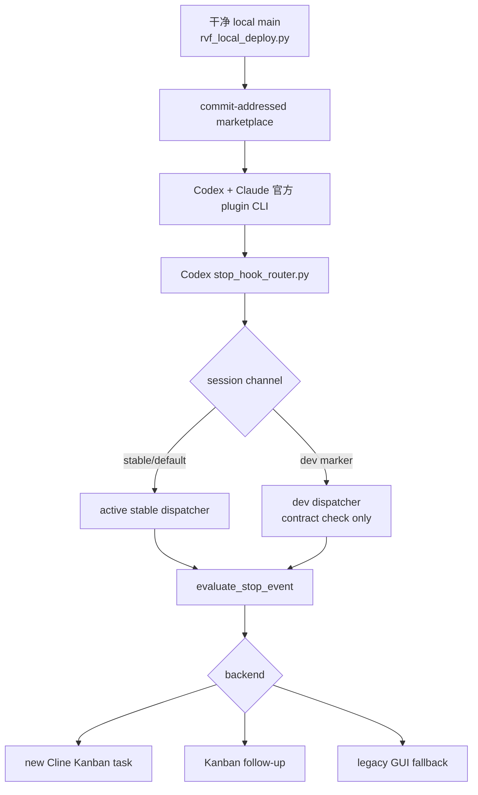

# Review Validate Fix

这是 `$review-validate-fix` workflow 的源仓库。仓库以
`plugins/review-validate-fix/` 为唯一 plugin 源，同时支持 Codex 与 Claude Code。
开发者安装不直接复制宿主 cache，也不要求目标 commit 已 push：本地 `main` 上的部署入口会生成
精确对应当前 commit 的自包含 marketplace release，再调用两个宿主的官方 plugin CLI。

## 跨 harness 支持

as-built 兼容性矩阵、core/adapter 边界与 payload 枚举见
[`docs/architecture/cross-harness.md`](docs/architecture/cross-harness.md)，通用规范见
[`docs/multi-harness-plugin-guideline/`](docs/multi-harness-plugin-guideline/)。

- **Claude Code**：adapter-backed。plugin manifest 注册 `Stop` 与 `UserPromptSubmit` hook，薄 shim
  转发到共享 core。
- **Codex**：native plugin。官方 plugin CLI 管理 marketplace、plugin cache 与 installed-plugin
  状态；由于官方 CLI 尚不管理全局 Stop/UserPromptSubmit hook，RVF wrapper 只结构化维护
  `~/.codex/hooks.json` 中的 RVF hook 项。
- **OpenCode / Cursor / Hermes / OpenClaw**：host adapter 仍为 reference-only。Cursor 作为
  alternative reviewer 的能力与 host-adapter 状态无关。

本仓库使用 `(M+N) Marketplace + Nested manifest`：Codex 模板位于
`.agents/plugins/marketplace.json`，Claude Code 模板位于 `.claude-plugin/marketplace.json`，宿主
manifest 位于 plugin 内的 `.codex-plugin/plugin.json` 与 `.claude-plugin/plugin.json`。

## 核心运行模型

RVF 的 Stop hook 默认通过 `kanban` CLI 创建真实 Cline Kanban task，或在已有 Kanban task
中注入 follow-up 用户消息。task 在独立 worktree/checkpoint 中重放当前 session-owned dirty
scope，供开发者使用 diff viewer、checkpoints 和 inline comments 审阅。Codex GUI fork 仅为
legacy backup-of-backup；Stop continuation 不是 RVF backend。

## 仓库结构

```text
.agents/plugins/marketplace.json                        # Codex marketplace 模板
.claude-plugin/marketplace.json                        # Claude Code marketplace 模板
plugins/review-validate-fix/                           # 唯一 plugin 源
plugins/review-validate-fix/.codex-plugin/plugin.json  # Codex nested manifest
plugins/review-validate-fix/.claude-plugin/plugin.json # Claude Code nested manifest
plugins/review-validate-fix/hooks/                     # Claude Code hook shims/manifest
plugins/review-validate-fix/skills/                    # RVF skills 与运行脚本
core/                                                  # host-agnostic core
adapters/{codex,claude_code}/                          # host adapters
core/rvf_user_local_data_paths.py                      # 统一 user-local state resolver
scripts/rvf_local_deploy.py                            # 唯一开发者本地部署入口
scripts/install_to_codex.py                            # bundle builder + 官方 CLI 编排器
scripts/check_plugin_contracts.py                      # plugin contract 入口
scripts/check_skill_contracts.sh                       # 完整仓库契约与测试入口
tests/                                                 # 不随 plugin runtime 分发的测试
```

## 开发维护流程

运行期改动进入 `plugins/review-validate-fix/`、`core/` 或 `adapters/`；仓库级安装、验证工具和
测试进入顶层 `scripts/` 与 `tests/`。plugin runtime 不携带仓库级测试或安装器。

开发者安装的前置顺序固定为：

1. 在 task worktree 完成实现和 RVF review。
2. 使用 `rvf-land` 把已审工作交回 task branch。
3. 使用 `base-branch-sync` 把完成的 task commit 同步到本地 `main`。
4. 进入唯一且实际 checkout `refs/heads/main` 的 worktree。
5. 在 local `main` 执行完整 contract check 和部署入口。

```bash
bash scripts/check_skill_contracts.sh
python3 scripts/rvf_local_deploy.py \
  --expected-local-main-commit HEAD \
  --json
```

部署与完整契约检查会先选择已有工具环境，要求 **Python >=3.11、`tomllib` 和同环境 pytest**。
自动选择优先使用 RVF 自有 `.venv`，其次是已有的 Python 3.12，再检查当前解释器和其他已安装
Python；调用仓库或当前激活的外部 venv 不自动成为 RVF 的环境。选择器可由系统 Python 3.9
自举，实际部署与测试会切换到通过预检的解释器，不需要修改系统 Python 或全局 PATH。

需要固定环境时，显式设置绝对路径：

```bash
export RVF_TOOL_RUNTIME_PYTHON_EXECUTABLE="/path/to/python3.12"
"$RVF_TOOL_RUNTIME_PYTHON_EXECUTABLE" scripts/rvf_local_deploy.py \
  --expected-local-main-commit HEAD --json
```

预检只发现已有环境，不下载 Python 或安装依赖。显式配置不合格时直接失败，不静默回退；
缺 pytest 也不会退回版本不足的 Python。单独运行测试时使用
`"$RVF_TOOL_RUNTIME_PYTHON_EXECUTABLE" -m pytest`，避免裸 `pytest` 指向另一份环境。
可用 `python3 -B scripts/rvf_tool_runtime_python_environment.py` 只查看选择及预检结果。

Python 与 shell 子进程继承固定的 `RVF_TOOL_RUNTIME_PYTHON_EXECUTABLE`；仅本次工具进程的
PATH 增加一个 `python3` 转发入口，保证嵌套调用也使用同一环境，结束后自动清理。
部署 JSON/持久回执及契约 timing report 的 `tool_runtime_python` 记录实际绝对路径、版本、
选择来源和模块预检结果。`python_version_too_old`、`python_dependency_missing`、
`configuration_missing`、`configuration_read_failed`、`configuration_parse_failed`
分别表示版本不足、依赖缺失、配置缺失、配置读取失败和配置解析失败。
Python 预检失败发生在部署锁和安装之前，JSON 的 `phase` 为 `python_runtime_preflight`；
此时没有生成新的持久部署回执，上一份回执不代表本次结果。

`--expected-local-main-commit` 可接受 commit-ish，入口会先解析成完整 SHA 并要求它精确等于
local-main HEAD。省略时仍只从当前 local-main HEAD 安装，并把该 SHA 写入 receipt。入口不会
fetch、push、land、merge 或 sync；门禁失败只给出修复指引并 fail closed。

部署入口会拒绝：

- 从 task worktree 或 detached HEAD 运行的旧 installer；
- 不唯一或未 checkout 的 `refs/heads/main`；
- `HEAD != refs/heads/main` 或 expected SHA 不匹配；
- merge、rebase、cherry-pick、revert、bisect 等未完成 Git 操作；
- 缺少必要 capability 的 Codex/Claude Code CLI。

部署 payload 来自 RVF 专属 deploy 源 worktree 的固定 HEAD；local main 的未提交内容不会
参与打包，也不会被 stash。无需 Git remote 包含该 commit：版本和 payload 只由本地、
已提交的 local-main 内容生成。

## Commit-addressed marketplace release

`scripts/install_to_codex.py` 是部署入口内部使用的 builder/orchestrator，不是开发者绕过门禁的
第二入口。它从 local-main commit 生成版本：

```text
<base>-dev.<commit-count>+g<sha12>
```

例如 `0.1.0-dev.317+gabc123def456`。生成过程只改 staging/release 产物，不改 local-main
manifest。bundle 自包含 plugin、`core/`、`adapters/` 与 Python import root，不包含 reviewer
registry、runtime state、run logs 或 deployment receipts。

生成物分两层：

- immutable release：`~/.rvf/developer-plugin-marketplace-releases/review-validate-fix/<full-sha>/`
- active marketplace：`~/.rvf/developer-plugin-marketplaces/review-validate-fix-local-main/`

release 在 staging 中完成 manifest、import、内容 digest 与 Claude plugin validate 后才原子
激活。active marketplace 和宿主 cache 都是安装产物，不是第二个 source checkout。

## 官方 CLI 安装契约

marketplace identifier 固定为 `review-validate-fix-local-main`，plugin selector 固定为：

```text
review-validate-fix@review-validate-fix-local-main
```

RVF 使用 `shutil.which` 解析真实 executable，并以 `subprocess.run([...], shell=False)` 调用：

```bash
# Codex 首次安装
codex plugin marketplace add <active-marketplace>
codex plugin add review-validate-fix@review-validate-fix-local-main --json

# Codex 更新（当前 CLI 无 plugin update）
codex plugin remove review-validate-fix@review-validate-fix-local-main --json
codex plugin add review-validate-fix@review-validate-fix-local-main --json

# Claude Code 首次安装
claude plugin marketplace add <active-marketplace> --scope user
claude plugin install review-validate-fix@review-validate-fix-local-main --scope user

# Claude Code 更新
claude plugin marketplace update review-validate-fix-local-main
claude plugin update review-validate-fix@review-validate-fix-local-main --scope user
```

这里展示的是宿主契约，正常开发部署仍只运行 `scripts/rvf_local_deploy.py`。RVF 不直接写
Codex/Claude Code plugin cache、settings 中的 plugin enablement 或 installed-plugin 元数据，
也不依赖 alias、shell function 或交互 shell。任一宿主安装或验收失败时，事务会恢复上一
active release，并通过官方 CLI 恢复上一安装；首次安装失败则清理半安装状态，最终非零退出。

## User-local 可变状态

所有可变状态默认位于 `~/.rvf/user-local-data`，可用 `RVF_USER_LOCAL_DATA_ROOT` 整体覆盖：

```text
reviewer-configuration/reviewer-registry.json
runtime-state/
run-logs/
deployment-receipts/
```

显式 `CODEX_RVF_LOG_ROOT` 与兼容的 `CODEX_RVF_STATE_DIR` 仍优先覆盖日志根。plugin cache 可
随时替换，不承担可变状态持久化。Codex hook wrapper 注入这些 user-local 路径；Claude hooks
由 plugin manifest 管理。

本机从旧 `~/plugins/review-validate-fix` layout 升级时，迁移必须是一次性、可恢复且带备份的
本机操作；项目不保留长期 legacy fallback。迁移记录写入已忽略的
`dev_backward_compatibility/`，不得进入发布 payload。

### 日志排障入口

默认查看：

```bash
cat ~/.rvf/user-local-data/run-logs/latest.json
cat <summary_path>
cat <events_path>
```

`latest.json` 只是 pointer；主程序和测试应读取 `summary.json` 或 `events.jsonl`。可用
`CODEX_RVF_LOG_MAX_INLINE_BYTES` 与 `CODEX_RVF_LOG_LEVEL` 调整诊断输出，不改变 hook 协议。

## Stop hook 与 Dev-only 标准

Codex 的全局 hook 入口是 active plugin 中的 `stop_hook_router.py`。router 默认选择 stable
channel；只有当前 session 显式设置 `RVF_STOP_HOOK_CHANNEL: dev` 或已有 dev marker 时才转发
到 dev checkout dispatcher。dev channel 可以针对匹配的 `CODEX_RVF_DEV_REPO` 运行
`scripts/check_plugin_contracts.py`，但 Stop dispatcher 永远不执行安装。稳定部署只发生在已完成
`rvf-land` 与 `base-branch-sync` 后的干净 local `main`。

`scripts/install_to_codex.py`、`scripts/rvf_local_deploy.py`、contract scripts 和 `tests/` 均为
Dev-only，不属于分发 runtime。新增开发工具必须位于顶层 `scripts/`、`tests/` 或显式 dev-only
路径；bundle builder 与 contract check 会阻止它们泄漏进 payload。

Stop backend 默认 `auto`：存在 Kanban task id 时使用 `kanban-followup`，否则创建新的 Cline
Kanban task。常用配置通过环境传给部署入口并由 hook wrapper 结构化持久化：

```bash
CODEX_RVF_FORK_MODE=cline-kanban \
CODEX_RVF_CLINE_KANBAN_START_CMD='kanban --no-open' \
CODEX_RVF_CLINE_KANBAN_TASK_CMD='kanban task' \
python3 scripts/rvf_local_deploy.py --expected-local-main-commit HEAD --json
```

默认依赖 PATH 上稳定安装的 `kanban` binary，不把 `npx -y kanban@...` 写入长期 hook 配置。
Cline Kanban task、bootstrap artifacts 和 prompt 都记录在同一 RunLedger；默认不自动 commit、
push 或 open PR。

### Stop hook 工作流



### 当前 session 开关

在用户消息中单独放一行可控制当前 session，不修改全局 hook：

```text
RVF_STOP_HOOK: off
RVF_STOP_HOOK: on
RVF_STOP_HOOK: status

RVF_STOP_HOOK_CHANNEL: dev
RVF_STOP_HOOK_CHANNEL: stable
RVF_STOP_HOOK_CHANNEL: default
RVF_STOP_HOOK_CHANNEL: status
```

状态写入 `~/.rvf/user-local-data/runtime-state/session-hook/`。默认 channel 永远是 stable；repo
路径或 repo 名不会自动选择 dev。控制行属于 hook 会话元数据，不是 review scope。

## Multi-harness double review

RVF 的 santa-method 默认派发恰好两路 external CLI reviewer，由
`dispatch_reviewers.py` 统一 probe、路由和执行。默认选择 Cursor 加非主 harness；可用 external
不足时按 reviewer registry 的降级规则处理，只有 0 个 external 可用才进入明确标记的
in-harness last resort。

默认 registry 模板随 bundle 发布；持久用户配置位于：

```text
~/.rvf/user-local-data/reviewer-configuration/reviewer-registry.json
~/.rvf/alternative-reviewer-config-overrides/<reviewer-id>.json
```

override 只允许覆盖 `env_set`、`health_command`、`health_timeout_seconds`、`pre_run_health`，且
必须声明 `schema_version: 1` 和与 bundled config 一致的 `reviewer_label`。override 值不会写入
dry-run、ledger 或 reviewer summary。

普通用户的 bundled Claude reviewer 默认仍直接执行 `claude`。仅存在对应 user-local override
的用户会路由到个人代理，例如 better-ccflare `127.0.0.1:8080`；`pre_run_health` 失败时 reviewer
不启动，且不会回退到直连。重新部署不会覆盖该 override。

## 验证

完整检查：

```bash
bash scripts/check_skill_contracts.sh
python3 scripts/check_plugin_contracts.py
```

默认启用并行测试：

- `RVF_CONTRACT_PARALLEL_TESTS=1`
- `RVF_CONTRACT_PARALLEL_JOBS`：不设时按本机推导 —— `max(2, 核数 / 3)`，且 1 分钟 load
  average 超过核数时再折半（下限 2）。10 核机器上等于 3；显式设置仍然优先。
  系数取 `/3` 而非更高，是因为并行组是滑动 FIFO 窗口（窗口满时等的是队首而非任意先完成者，
  macOS 自带 bash 3.2 没有 `wait -n`），实测有效并发被压在 3.82：jobs=5/6/7/8 四档墙钟
  完全相同，但峰值 CPU 从 3.39 核涨到 5.85 核。想换回原来的速度用
  `RVF_CONTRACT_PARALLEL_JOBS=5`（墙钟与旧默认 8 一致，占用少四成）。
  每次并行执行会打印一行 `RVF_CONTRACT_PARALLEL_EXECUTION jobs=… cpu=… load1m=…`，
  契约失败时会被记进 deploy receipt。
- `RVF_CONTRACT_REVIEW_SUPPORT_SHARDS=4`
- `RVF_CONTRACT_STOP_HOOK_SHARDS=4`
- `RVF_CONTRACT_DISPATCHER_SHARDS=1`

串行复现：

```bash
RVF_CONTRACT_PARALLEL_TESTS=0 bash scripts/check_skill_contracts.sh
```

单独诊断 shard：

```bash
python3 tests/test_review_support_scripts.py --shard-count 4 --shard-index 0
python3 tests/test_stop_review_validate_fix.py --shard-count 4 --shard-index 0
python3 tests/test_stop_hook_dispatcher.py --shard-count 2 --shard-index 0
```

部署验收由 `verify_local_deploy.py` 执行：查询两个官方 CLI 的 marketplace/plugin 状态，核对
selector、生成版本、payload digest、Codex hooks、共享 user-local state，并运行真实发现与 hook
smoke。最终 receipt 记录 local-main SHA、版本、CLI 版本、marketplace identifier、digest、smoke
证据与 rollback 状态。
