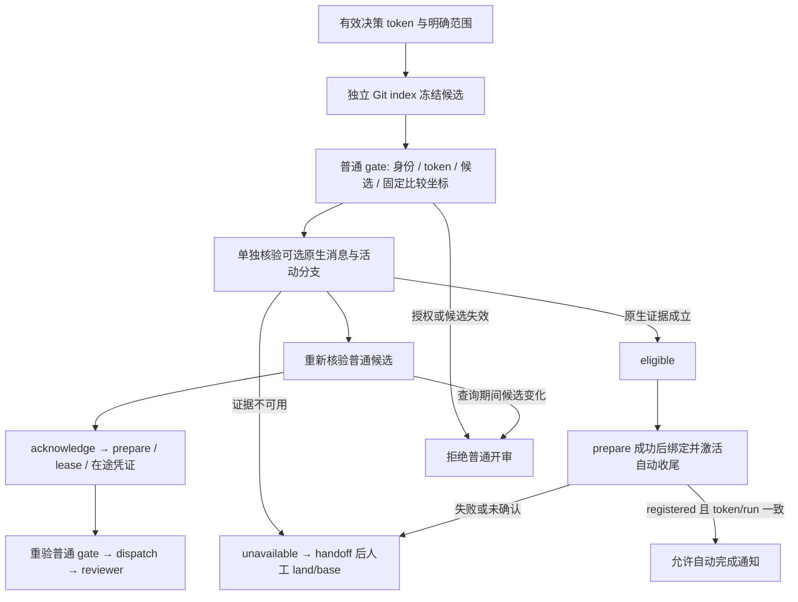

# RVF 审查候选快照与可选原生回退契约

普通 RVF 的准入是有效授权、明确范围与不可变候选快照，不要求特定 Agent Harness 发行版本，也不要求宿主具有原生回退接口。

## 普通审查与自动回退分别取证（49d13 / f00ae）

- `review_candidate_snapshot` 使用 `rvf-review-candidate-snapshot/v1`，绑定决策 token、会话、工作目录、候选指纹、HEAD、固定比较坐标及独立 Git commit/tree；不声称存在原生 UserMessage。
- 快照通过独立 index 创建，不移动 HEAD 或修改真实暂存区。prepare、重试与 dispatch 重验候选内容、权限、链接及 run 归属；仅文件时间变化且内容相同不使普通审查失效。
- prepare 与范围说明重渲始终用固定 `checkpoint_commit` 生成 packet 的 diff、文件正文及摘要。Git diff 使用临时 bare 元数据与原仓只读对象，隔离活动 `.gitattributes`、真实 index 和全局属性；纯 dirty tracker 仍保留 hunk 投影，超限新增正文在所有 diff 中一并省略。
- 生效的仓库排除策略及仓库内链接依赖独立冻结。`packet_context_only_paths` 绑定只作为策略上下文捕获的路径；它们不进入候选指纹、primary scope、审查 diff 或新增正文。策略解析在冻结 tree 中完成，支持内部相对、绝对及中间目录链接。
- `review_start_boundary_receipt` 保持原生凭据 v1，作为可选自动回退证据；它与候选快照是不同对象。无 receipt、无控制端点、未适配的 Harness 或未知发行版本均不阻断普通 review/fix/handoff。
- `automatic_closeout_eligibility` 记录 `eligible` 或 `unavailable` 及真实原因；不可用时固定为 handoff 后人工 land/base 同步，不伪造正向能力或用户原话。
- `automatic-closeout-registration.json` 的 `pending/registered/disabled` 是运行注册事实；只有确认 registered 的新运行才发布自动完成通知。绑定、激活失败或响应未知只禁用自动动作，普通 start 仍成功；RVF 的完成通知出口每次核对该记录，避免迟到激活造成双重收尾。
- 调用身份错误、token 撤销、真实候选变化、错误 run 绑定继续失败关闭。单个原生 reader 的版本、消息或 nonce 检查不再决定普通审查资格。
- 原生 capture、receipt 读取或校验失败（包括原生 `invalidated`）统一记录资格 `unavailable`，保留原因；原生查询结束后再次独立核验候选，不能让降级掩盖查询期间的内容、HEAD 或权限变化。prepare 显式提供的决策 token/候选快照决定普通授权，环境变量中的原生 receipt 不能替换它。
- 完成通知冻结与发布均要求注册文件存在、可读、状态为 `registered`，并与原生 receipt 的 token 和 finalization 的 run 一致。缺记录不提供旧运行兼容放行；即使已有冻结通知，注册失效后也不能发布。
- 直接 prepare 使用 `--decision-token <真实 token>`；无授权、无明确范围时不创建正式 run，不提供通用 bypass 开关。

下文的独立消息、nonce、活动分支和原生回退规则仅约束可选自动恢复。历史事故用于解释这些自动动作为什么需要准确证据，不是普通审查的全局前置要求。

## 事故与偏差

研究基线和本任务 bootstrap 基线为本地 `main` 的 `0ac2e595521673cc2f316cfbd44f13f45e2d835c`；实施期间又单向吸收 `851a00d10b62bbdeac859f8eea07dad5004edbf9` 的无看板 Codex GUI 关闭策略，保留本任务全部 WIP，未反向更新 main。事故现场只读，未重跑或修改 Trace-of-Thought 的 `1d2b0`。

| UTC 时间（2026-10-18） | 事件 | 能证明什么 |
| --- | --- | --- |
| 20:21:27.155 | Stop 创建 `513533daf14bfed7`，transport 为 cline-kanban task chat | 存在征询意图，不证明已消费 |
| 20:21:29.632 | Codex 收到原生独立消息 | 第一轮确有消息分界 |
| 20:21:42.237 | Agent 选择 `deferred_until_condition` | 等待 b0669 修复及验收 |
| 20:30:30.921 | 用户交接运行时成果 | 前置条件的新证据，原文没有明确重新开审命令 |
| 20:44:32.025 | Agent 调用已删除的旧重开入口并自填 reason | 执行偏差：把自己的判断当成用户口头请求 |
| 20:44:32.625 | `f5ea163d178641e0` 创建并接受；transport/status 为空，explicit 为 true | 设计缺口：CLI 接受自述来源，mint 后直接 acknowledge，无新消息 gate |
| 20:44:39—52 | 已分配 lease、准备 run | 正式副作用已发生，不能等到 dispatched 才定义开审 |
| 20:46:15.408 | run `rvf-20261018T204434Z-agentic-initiation-start-c34d2857` 派发 | 第二轮没有新的独立消息分界 |

两枚 token 的候选指纹不同，第一轮分界不能覆盖后续实现。原 token 的终端投递 ledger 曾显示 `delivered_and_submit_confirmed`，而 token 字段仍 pending，说明投递状态本身也需对账。相关 Kanban ledger 的 turn 6 checkpoint 创建于 20:21:20，早于 token；它是复制的 latest checkpoint，不能证明与本次消息绑定。

证据入口是创建需求中的两枚 token、来源更正文档、run handoff 及原始 rollout。只摘录用户消息与工具调用的事件事实，不导出内部推理或整段会话。

## 普通审查与可选自动恢复的状态链



- mint、候选计算、投递意图和 receipt/run 绑定意图是轻量协调记录，不运行 reviewer、不分配审查 lease。
- `acknowledge` 是最早正式副作用；消费 reopen 意图、分配 lease、创建正式 run/prepare 工件、arm 在途凭证也算正式开始。诊断用 Stop ledger 不等于正式 review run。
- `start` 在 acknowledge 前验证普通授权与候选；默认 prepare 流水线在创建 run 前再验证；直接 `prepare_run`、prep 文件重放以及 reviewer 的直接、CLI、detached 执行均检查同一候选快照。旧 Stop 路由在 precheck/reopen/allocate 前检查，fork、prep 写入与冻结入口也验证同一普通准入条件。off/report-only 和 dry-run 诊断不创建正式 prep 或接受决策，诊断的计划工件不能直接派发。
- `accepted`、`submitted`、`delivered_and_submit_confirmed`、模型声称消费，以及 `initiated_by_explicit_user_request` 都不是 gate 的授权证明。
- Git checkpoint 与会话回退是两个能力。隔离 Codex CLI 0.163.0 实测：Stop 的 `<hook_prompt>` 虽在 rollout 中是 role=user，却不是原生独立回退 prompt；独立用户消息可以选中回退，界面说明只回退会话、文件不变。Git 快照负责保存候选内容，不能声称 Codex 原生 rewind 会恢复文件。

## 可选自动恢复的原生证据门禁

实现入口：`core/review_start_boundary/review_start_boundary_verification.py`、Codex 原生证据 reader、`scripts/review_start_boundary_gate.py`。

原生 reader 识别 `originator=codex-tui`、`source in {cli,vscode}` 的事件格式，不依据 `cli_version` 放行或拒绝。历史 0.163.0 是实验样本版本；新版本在当前协议与真实宿主证据成立时同样可用，GUI、exec 等形态不会借用 TUI 的回退证明。本次直接启动 TUI 的隔离 app-server 实验原生记录 source=vscode，当前 Kanban TUI 记录 source=cli；source 字段单独不能证明 VS Code 扩展或 GUI 的回退能力。每次执行严格原生资格校验时，先验证静态 receipt、原始 JSONL 和 Git 候选，再在确认原生资格前重新查询宿主实时活动分支；首次没有静态 receipt 时另先向宿主取一次，最后的实时查询仍不可省略。JSONL 要求 `session_meta.id` 相同、`task_started.turn_attribution.turn_trigger=user`、对应 turn 的 `item_completed.item.type=UserMessage` 和原生 message ID 相符。只存在 `response_item.role=user` 不算证据；后续出现另一用户发起的工作 turn、消息被截断移除或发生已持久化 rollback 都拒绝旧分界。真实 PTY 实验进一步确认：TUI 已显示回退后，原始 rollout 仍保留旧 UserMessage，静态 reader 仍判存在；所以它只证明消息曾存在，活动分支资格必须由本次 nonce 查询的宿主快照证明。重启后也不复用旧分支观测。

自动正文必须精确包含本 token 的独立单行边界标记，不能混入其它输入。自动来源的 token 必须为 explicit=false；手动来源必须对应原生明确 `/review-validate-fix`、`$review-validate-fix` 或 `:review-validate-fix` 主 skill 调用，也接受合法的前置文字及命名空间形态，例如 `now $review-validate-fix:review-validate-fix your own work.` 和 `$rvf:review-validate-fix`。UPS 与 verifier 共用纯文本识别与抑制规则；`$rvf:review-validate-fix` 等其它命名空间在 UPS 仍须由 Codex `text_elements` 确认，verifier 先核实 manual UPS provenance，再识别该原文，不扩大 UPS 的文本 fallback。兄弟 `rvf-*` skill、交接正文和被引号包裹的普通提及不能代替主 skill 调用。原文仍须是通过宿主证明的独立 user turn，并同时满足 `initiated_by_explicit_user_request=true`、`developer_manual_trigger_via_user_prompt_submit` provenance、原始消息 SHA256、完整 checkpoint 绑定及实时活动分支证明；合法命令形态本身不构成开审授权。Agent 自填 reason 不参与来源裁决。

自动消息的原生接收时间必须在 token 创建与到期之间。手动命令允许原始消息先于 UPS 铸 token，间隔最多 120 秒；这不放宽消息、会话与快照绑定。过期、迟到、无有效在途锚点的 token 不得直接 prepare。

快照必须使用 40 位不可变 commit，tree、HEAD、当前候选指纹、文件身份/mtime/ctime 签名、候选文件内容 SHA256、比较基线及其本地 ref tip 都重新核验。commit 正文必须有且只有一行 `RVF_REVIEW_START_BOUNDARY_BINDING=<JSON>`，内容等于下述绑定字段，不能复用任意 latest commit。Git 子进程清理继承的 `GIT_*` 仓库定位变量。还核对文件类型、执行权限、仓库内符号链接及 gitlink commit；仓库外链接和带未冻结修改的 submodule 拒绝使用本快照证明。

通过验证后，先用排他锁将原生 session/message 绑定到唯一 token 和静态 receipt 摘要，再绑定唯一 `run_id/run_dir`；同一消息不能借给另一 run。相同 token、静态 receipt 摘要、真实 `run_id` 与规范化 `run_dir` 才允许重入。所有 token 的绑定写入共用排他锁，并从同一组不可变 `*.run-binding.json` 记录核对反向归属；既有 run_id 或目录均不能被另一 token 占用。bridge 复用该绑定器，不能重写事实或从目录名推断 run_id；完成通知也使用冻结的真实 run_id。prep 必须在 completed 缓存返回及 startup scope/run 工件落盘前完成验证与占用。普通 run 重入仍须通过候选 gate；后续 turn 或原生分支变化只影响自动恢复资格，真实候选变化和错误 run 归属仍拒绝。原生消息不能被直接转给新 token 或新候选。

## cline-kanban 的生产接口与责任

RVF 发送独立边界标记，使用 `--deliver-when-agent-idle`，空闲等待上限为 token 剩余 TTL 减 196.5 秒终端投递预算；先落 intent，再发送。Kanban 用 task+幂等键约束重复投递。请求过程中退出、重启或未确认时复用相同派生 token/key，不在当前工具调用的 turn 内继续 start。

cline-kanban 负责证明以下因果次序：目标会话确定 → 原生独立消息提交 → 原生消息/turn 已可选作 rewind 分界 → 针对此消息捕获准确 Git 内容快照 → 提供 receipt。不能把任务卡 latest checkpoint 无条件贴到消息回执上。应捕获准确消息/turn 的 immutable checkpoint，保全 ref 以免被 GC，并在 rewind/重建会话时按活动分支更新或撤销证明。

`kanban task message-status` 应在原有回执中增加 `independent_user_turn_boundary_receipt`。RVF 当前消费者已支持该字段；每次 gate 还会通过 `--review-start-boundary-observation-nonce <本次随机 nonce>` 请求活动分支快照。CLI 若不支持此参数，或没有完整观测时，原生资格不可用；普通审查在授权与候选核验通过后继续。canonical receipt、prep/contract 内的 receipt 和 `RVF_REVIEW_START_BOUNDARY_RECEIPT` 都只定位并冻结静态证明，不能跳过实时查询。现有手动消息也需宿主为其生成可查询的原生消息记录；用户的明确命令本身可以充当消息分界，仍需 checkpoint 和当前分支证明。

宿主必须返回 `review_start_boundary_active_branch_observation`，含本次 `request_nonce`、查询的 task/key/session、`native_active_branch_user_message_ids` 和 `native_active_branch_user_turn_id`。边界消息必须恰好出现一次，当前 user turn 必须与 receipt 相同。nonce 必须来自本次请求；不得回显旧查询、用 accepted/submitted 代替，或仅把历史 rollout 末尾当作活动分支。宿主需通过真实原生控制面观察 UI rewind 后的当前分支；无法证明时不返回正向观测。该 producer 的当前源码已提供控制端点查询；每次仍须证明端点属于当前 TUI 及 incarnation，并在查询后复核身份。源码、部署和跨仓原生端到端验收分别记录，不能相互替代。

```json
{
  "review_start_boundary_active_branch_observation": {
    "request_nonce": "<本次 RPC 随机 nonce>",
    "kanban_task_id": "<task>",
    "idempotency_key": "rvf-decision-point-<token>",
    "session_id": "<native session>",
    "native_active_branch_user_message_ids": ["<当前分支真实 UserMessage ID>"],
    "native_active_branch_user_turn_id": "<当前独立 user turn>"
  }
}
```

最小对象示例（值均为宿主实际观测，示例不能用于生产）：

```json
{
  "schema": "rvf-independent-user-turn-boundary/v1",
  "decision_token": "<token>",
  "kanban_task_id": "<task>",
  "idempotency_key": "rvf-decision-point-<token>",
  "session_id": "<native session>",
  "worktree": "<absolute worktree>",
  "transcript_path": "<native active transcript>",
  "native_user_message_id": "<selectable native message>",
  "native_turn_id": "<independent user turn>",
  "boundary_message_sha256": "<raw native message SHA256>",
  "source": "rvf_automatic_decision_message",
  "candidate_fingerprint": "<RVF candidate fingerprint>",
  "candidate_filesystem_state_sha256": "<candidate filesystem identity signature>",
  "worktree_head_commit_sha": "<HEAD at boundary>",
  "comparison_base_tip": null,
  "comparison_base_ref": "main",
  "comparison_base_ref_tip": "<local main commit>",
  "checkpoint_commit": "<immutable commit>",
  "checkpoint_tree": "<tree containing candidate contents>"
}
```

文件身份签名由 RVF 的 `candidate_filesystem_state_sha256(repo, candidates)` 计算，producer 应调用同一 Python 实现，避免跨语言整数精度与文件时间单位差异；内容改后写回原样仍需新分界。

checkpoint 的 JSON 绑定字段见代码 `CHECKPOINT_BINDING_FIELDS`，不含 commit 自身以避免循环哈希。宿主需保留 message→checkpoint 映射；仅有 Git commit 正文不能证明宿主已经提供了原生可选回退。

历史 e9e12 的“producer 尚未实现”是当时状态。当前修复由 RVF 40659 与 cline-kanban 87345 分别在独立 worktree 实施；CLI 异步吞错复用既有 caaa3。源码和隔离联验结果不等于生产安装已更新。Claude Code/Kimi 适配器明确报告原生能力未取证；普通审查继续并交接人工收尾，不能静默沿用 Codex reader。

## 自主恢复与旧路径移除

`rvf request-review-start-boundary --deferred-decision-token <旧 token> --reason "条件满足的自主判断"` 只适用于本会话最近的延后型谢绝。结构性谢绝、旧 token 或其它会话拒绝。普通未开始 token 可用 `--decision-token` 请求新分界；旧分界被撤回，派生 token 的来源仍是自动请求。延后重问仅释放延后条件门，冷却、结构性 snooze、铸造熔断不获得用户显式请求的豁免。

删除旧 `--reopen-own-declined-decision` parser、执行函数、伪口头来源常量、技能指引及旧正向测试。不迁移或重写历史 token。旧 CLI 参数报错；缺原生证据不阻断有效 token 的普通审查，但不能注册自动恢复。项目未正式分发，未增加旧入口适配器或兼容框架。

推荐方案是“下一独立 turn 重投 + 统一副作用 gate”组合。只重投仍可被直接 prepare/dispatch 绕过；只加 gate 而不提供自主重投会造成无恢复路径。每轮人工确认会削弱用户要求保留的自主性，所以未采用。

| 机制 | 收益 | 成本与限制 |
| --- | --- | --- |
| 仅延后恢复重新投递 | 保留自主判断，恢复时产生新消息 | 直接 start/prepare/dispatch 仍可绕过，不能独立满足不变量 |
| 仅统一来源与 checkpoint gate | 首个正式副作用前集中拒绝缺证据路径 | 缺少自主恢复入口时停在 pending；静态历史也不能识别原生 UI 已回退 |
| 重投与实时分支 gate 组合（本次采用） | 自主恢复和所有正式入口执行同一约束 | 需要宿主生产准确 receipt 与实时分支观测；接口未就绪时保持 pending |

## 验收矩阵

| 场景 | 必须观察 | 自动化证据 |
| --- | --- | --- |
| 初次普通发起 | 有效 token 与独立候选快照先于 acknowledge/prepare；原生资格单独记录 | 专用 pytest：真实隔离 Git、合成宿主事件/实时观测接口替身，正向到真实 prepare；原生 PTY 实验单独验证可回退能力与静态历史的盲区 |
| 延后自动恢复 | 新 token、新消息请求，explicit=false，当前 turn 不开审 | 专用 pytest：重复请求、未接受状态、来源字段 |
| 原生手动回退证据 | 原始独立主 skill 命令（含前置文字与命名空间）+ manual provenance + 新绑定 commit | 专用 pytest 正向；兄弟 skill、交接正文、普通提及、hook 与伪来源反例拒绝 |
| 条件满足但缺原生新 turn | 普通候选可继续；不冒充具备原生回退资格 | 专用 pytest 反例，不读取 accepted 作为成功 |
| 重复/失败/迟到/TTL | 相同请求 token/key；原生失败降级；真正过期或撤销的 token 拒绝普通开审 | 专用 pytest；Kanban 队列真实提交/消费仍须跨仓验收 |
| 候选/HEAD/固定比较坐标改变 | 普通快照失效；本地 base 后续推进不替换已冻结坐标 | 专用 pytest 与既有 bootstrap 回归新断言 |
| rewind/重启 | 撤销分支上的消息不可复用；重启重新读原生事件；一条消息不能绑定另一 run | 专用 pytest；隔离原生 Codex 选择回退实验 |
| 直接 prepare/dispatch/detached | 缺授权或候选证据时无正式副作用；缺原生证据继续普通流程 | 专用 pytest 及已有 dispatch 子进程回归的显式合成证明 |
| 其它宿主 | 未验证的原生能力为 unavailable，普通审查继续并人工收尾 | 适配器行为检查；不宣称原生 E2E 已通过 |

既有纯状态机/SOW 字段测试用可注入 gate seam 隔离其原有职责；它们不能计作真实分界完成证据。既有 prepare/dispatch 子进程正向回归改用独立测试夹具，生成实际隔离 Git commit、原生事件与 token，不设置生产 bypass。所有研究实例使用临时隔离配置，不写生产历史或事故状态。

## 关联任务与后续实施边界

- `c5db6` 处理延后后重问熔断，不因其 backlog 标题推断当前行为；本次不顺带改熔断策略。
- `9f7b5` / `8d3ac` 的投递对账、复工撤回与本地 main 上已有代码有关；它们不能证明正式开审前 gate 已存在。
- `87f2c` 研究延迟投递，cline-kanban 空闲队列相关修复已有部署；它不自动提供消息/checkpoint 的完整绑定证明。
- `cab9c` / `92ccd` / `f03b5` 聚焦完成后 rewind 的 marker/续跑；本次在开审之前设门，不覆盖其 marker 清理 WIP。
- cline-kanban `297ef` 正在实现完成后自动 rewind 与 land/base 同步，已记录其消费本任务产出的关联；它依赖准确开审分界，不等同于当前 producer 已实现。本契约可作为其对接输入，不在本任务代改该 checkout。

后续跨仓步骤：实现上述 producer → 在隔离 Kanban/Codex 实例验证真实独立投递、消费、可选 rewind 和快照绑定 → 验证自动恢复/失败/重启/rewind 矩阵 → 按独立授权执行本地安装。RVF 本任务只提交当前 worktree，不自动安装、不更新本地 main 或远端。

## 原生回合投递与捕获诊断（40659 / 87345）

自动首投和重请求均在 `--deliver-when-agent-idle` 基础上增加 `--require-native-independent-user-turn-for-session <session-id>`。持久字段 `requiredNativeIndependentUserTurnSessionId` 约束目标原生会话；summary 空闲只作初筛，宿主还须从当前 TUI 控制面证明前一原生 turn 已完成。等待不更新原始 TTL、不增加投递次数、不占用 PTY。身份变化或能力不可用不得退化为普通投递；同 key 的幂等比较包含严格约束。确认首次提交已经形成目标消息的新 turn 后，不得因该新 turn 正在运行而误报失败或补发重复消息。

bridge 与 reader 只共享转录格式判定：`codex-tui` / `source in {cli,vscode}`，版本不参与准入。`codex_cli_rs`、GUI、exec 等不同协议形态没有自动回退资格时，普通审查继续。完整 receipt 捕获成功仍不免除 gate 的当前候选验证及本次 nonce 活动分支查询。

`capture-rvf-review-start-boundary` 的响应为判别结果：`status=captured` 必须携带 `receipt`；`status=pending/invalidated` 携带 `reason`、`reason_code`、`recovery_action`，命令以非零退出。未知异常保持错误正文与非零码；exit 0 的空输出、坏 JSON 或不完整对象也不能算捕获成功。receipt v1 的字段和 checkpoint 绑定不变。

恢复动作区分 `wait_for_native_turn_completion`、`request_new_boundary_after_turn_completion`、`repair_host_capability`、`retry_capture`、`inspect_boundary_diagnostic`。同 turn 混入须等待真实回合完成再请求新分界；缺控制面或能力不符不靠重复 mint 解决。原生回退、候选或绑定失效继续拒绝旧分界，不改写旧 receipt/token。
