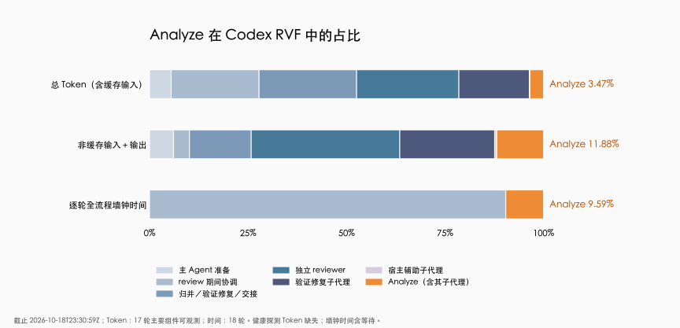

# Codex RVF 各组件耗时、Token 与 Analyze 占比实测

统计截止：**2026-10-18T23:30:59Z**。主窗口为 2026-10-11T23:30:59Z 至截止；对照窗口为此前 30 天。对象是所有项目中由 Cline Kanban 管理、主 Agent 为 Codex 的实际 RVF 轮次。

## 直接结论

**Analyze 占主要可观测组件总 Token 的 3.47%；按“非缓存输入＋输出”统计，占 11.88%；占本轮 RVF 启动至 Analyze 结束的墙钟时长 9.59%。**

按非缓存输入＋输出看，独立 reviewer 与验证修复子代理合计 61.79%；Analyze 的消耗占比低于这两类，也低于主 Agent 的归并／修复／交接区间。

- Token 来自 17 轮，覆盖 18 轮已结束 Analyze 的 94.44%；累计分母 587,497,306，Analyze 20,387,249。非缓存输入＋输出的分母为 19,190,362，Analyze 2,280,241。
- Analyze 主线程每轮中位数 **3.93 分钟**，P90 5.06 分钟。18 轮主流程墙钟累计 693.51 分钟，Analyze 累计 73.55 分钟，从启动到 Analyze 结束累计 767.07 分钟。这些是逐轮相加，不能当作机器上顺序执行的实际总等待。
- 当前代码在 finalize 后派发 detached tmux 线程，原 Task 无需等待 Analyze。**其后台持续时间不等于主任务增加同等等待**；共享额度或机器资源的间接竞争，现有记录不足以量化。
- 18 次 Analyze 进程均以 0 退出；采集时仅 **1/18** 通过正式归档检查，其余 17 份仍有 TODO。所有这些已发生的消耗均保留计账。

这里的 Token 百分比是**已观测组件口径**。102 次健康探测的 usage 未完整保存，不能宣称全量精确占比；在其余归属成立且仅遗漏非负的探测用量时，两个 Token 百分比是相应全量占比的上界。它们也不是美元费用或订阅额度消耗比例。



## 各组件的 Token 消耗

同一 17 轮样本；M = 1,000,000 Token。reviewer 含健康检查失败后启动的 fallback；Analyze 一栏包括其主线程及其派生的辅助子代理。

| 组件 | 独立记录数 | 总 Token | 总 Token 占比 | 非缓存输入＋输出 | 该口径占比 |
| --- | --- | --- | --- | --- | --- |
| 主 Agent：准备与派发 | 17 | 32.161 M | 5.47% | 1.165 M | 6.07% |
| 主 Agent：review 期间协调 | 17 | 131.059 M | 22.31% | 0.779 M | 4.06% |
| 主 Agent：归并、验证修复与交接 | 17 | 145.488 M | 24.76% | 3.005 M | 15.66% |
| 独立 reviewer（含 fallback） | 43 | 152.509 M | 25.96% | 7.239 M | 37.72% |
| 独立验证修复子代理 | 35 | 104.941 M | 17.86% | 4.619 M | 24.07% |
| 主会话的宿主辅助子代理 | 1 | 0.951 M | 0.16% | 0.104 M | 0.54% |
| Analyze 后台 LLM | 20 | 20.387 M | 3.47% | 2.280 M | 11.88% |

主 Agent 三个区间是按实际 reviewer 开始／结束时间窗划分；“归并、验证修复、最终验证与交接”缺少可靠的独立 phase 事件，合并展示。它们的 Token 归属可复算，但不能解释为每条响应都经过语义分类。宿主自动派生的 `skill_learner` 单列为辅助子代理。

Analyze 的缓存输入占自身输入的 89.80%，全部组件合计为 97.18%。大量重复上下文被缓存后，两种 Token 占比明显不同。已逐一核对 18 个 Analyze 主线程：`codex exec` 日志末尾的 `tokens used` **等于该线程非缓存输入＋输出**，而不是包含缓存读取的总 Token；额外辅助子代理另行相加。

## 各组件的时长

除 Analyze 为全部 18 个已结束主线程外，下表沿用 Token 主样本的 17 轮；reviewer、验证修复子代理按单个进程统计。父会话等待、独立 reviewer、子代理和后台 Analyze 可以重叠，**不能把本表累计列相加当作端到端耗时**。少数子代理只有 spawn 与最后 usage，持续时间是下界，明细中已标注。

| 组件 | 样本数 | 单组件中位数 | P90 | 持续时间累计 |
| --- | --- | --- | --- | --- |
| 主 Agent：准备与派发 | 17 | 2.38 分钟 | 3.25 分钟 | 40.84 分钟 |
| 主 Agent：review 期间协调 | 17 | 15.75 分钟 | 33.66 分钟 | 299.14 分钟 |
| 主 Agent：归并、验证修复与交接 | 17 | 16.19 分钟 | 28.79 分钟 | 322.92 分钟 |
| 独立 reviewer（含 fallback） | 43 | 6.01 分钟 | 17.86 分钟 | 347.29 分钟 |
| 独立验证修复子代理 | 35 | 6.89 分钟 | 12.28 分钟 | 298.13 分钟 |
| 主会话的宿主辅助子代理 | 1 | 40.45 分钟 | 40.45 分钟 | 40.45 分钟 |
| Analyze 主线程 | 18 | 3.93 分钟 | 5.06 分钟 | 73.55 分钟 |

确定性 finalize 在 17 轮中累计 11.084 秒，中位数 0.446 秒，本身不调用 LLM。代码把 `completed_at` 写在 scaffold 之前，因此该数字**不是 scaffold 的独立耗时**；scaffold 没有单独的可靠起止事件，只能保留 finalize 结束到 Analyze 派发的混合间隔。它不与 LLM Analyze 的几分钟混为一项。

单轮 Analyze 总 Token 占比中位数 3.64%、P90 6.05%；单轮时长占比中位数 10.32%、P90 14.49%。主结论采用“分子之和／分母之和”，并非单轮比例的平均值。

## 样本覆盖、项目与历史对照

近 7 天找到 22 个实际轮次：18 轮 Analyze 已结束、1 轮已 finalize 但没有线程启动记录、3 轮截至采样时尚未 finalize。后两类逐轮列出，不按零 Analyze 用量混入完成样本。已结束轮次中 `rvf-20261017T222629Z-agentic-initiation-start-be571a86` 的 `kimi-code` 用量无法恢复，排除于主 Token 分母，但保留在时长样本中。

| 项目 | 实际轮次 | Token 完整样本 | Analyze 总 Token 占比 | 非缓存输入＋输出占比 | Analyze 墙钟占比 |
| --- | --- | --- | --- | --- | --- |
| Trace-of-Thought | 3 | 3 | 3.02% | 9.08% | 7.54% |
| Trace-of-Thought-Landing-Page | 2 | 2 | 4.58% | 13.17% | 8.73% |
| cline-kanban | 16 | 12 | 3.51% | 12.89% | 10.47% |
| review-validate-fix | 1 | 0 | 未知 | 未知 | 未知 |

近 30 天找到 46 个 Codex RVF 轮次，其中 41 轮 Analyze 已结束，只有 18 轮主要组件 Token 可恢复，覆盖率 43.90%；该可观测子集的 Analyze 总 Token 占比为 3.59%、非缓存输入＋输出占比为 12.15%。它高度偏向近期数据，不能作为可靠的旧版本全量 Token 基线。

按 `summary.json` **记录的部署标签**分组如下；标签可能在后续操作中重写，不足以证明每个阶段始终使用同一版本代码。

| 记录的部署标签 | 实际轮次 | Token 完整样本 | Analyze 总 Token 占比 | Analyze 墙钟占比 |
| --- | --- | --- | --- | --- |
| 0ac2e5955216 | 22 | 17 | 3.47% | 9.59% |
| 76d068a3f23b | 6 | 0 | 未知 | 10.09% |
| 80b65c1fba0e | 2 | 0 | 未知 | 23.99% |
| d778584575f1 | 2 | 1 | 7.80% | 21.07% |
| f57cdf037911 | 14 | 0 | 未知 | 0.62% |

30 天累计墙钟占比只有 1.78%，但不能据此声称 Analyze 近期变慢：`rvf-20260923T074906Z-agentic-initiation-start-4619314f` 从创建到结束横跨 6.15 天，包含停顿等待；它显著放大分母。30 天的单轮时长占比中位数为 11.66%，更接近近期水平。

## 为什么现有汇总不能直接回答此问题

1. 现有 `usage-summary.json` 在 finalize 时生成，没有包含随后独立运行的 Analyze，也没有汇总外部 reviewer 和子代理。
2. 近 7 天的 18 轮已结束样本中，现有汇总全部从本轮 RVF 之前开始计时／计 Token。最新 `rvf-20261018T225400Z-agentic-initiation-start-62c05d10` 的原汇总为 46,637,335 Token，本轮主 Agent 重算为 12,976,434；两者之间有先前任务历史，不能直接作为 Analyze 分母。
3. 新版 Codex 的 collaboration 子代理可以只有 session metadata 的 `source.subagent.thread_spawn`，不再出现旧 `collab_agent_spawn_end`。本次以原生父子关系补齐主流程子代理和 Analyze 辅助子代理，并按生成时间排除实现阶段的历史代理。
4. 正式归档完成必须检查 `summary.md` 无 TODO 且 `causality.json` 可解析，不能只看退出码。最新日志明确报告沙箱拒绝写入 `~/.rvf`、内容只保存于 fallback 位置；本次仅报告现状，不修改这些运行产物。

本报告边界为**run 创建至 finalize，加该 run 的后台 Analyze**；创建前的实现／发起决策对话、finalize 后另行执行的 `rvf-land` 或 `base-branch-sync` 不纳入。它回答本轮 RVF 组件占比，不回答整个开发 Task 相对于“完全不做 RVF”的额外成本。

## 逐轮明细与复查

| run_id | 所属 Task | 主流程时长 | Analyze 时长 | Analyze 总 Token 占比 | 非缓存输入＋输出占比 | 正式归档完成 |
| --- | --- | --- | --- | --- | --- | --- |
| rvf-20261012T193340Z-agentic-initiation-start-ca750cf9 | cline-kanban/6377d | 32.56 分钟 | 6.11 分钟 | 9.82% | 17.05% | 否 |
| rvf-20261016T204918Z-agentic-initiation-start-3aa3ed36 | Trace-of-Thought-Landing-Page/b46e8 | 49.58 分钟 | 4.02 分钟 | 3.66% | 13.17% | 否 |
| rvf-20261017T210036Z-agentic-initiation-start-97ba0952 | cline-kanban/36156 | 33.43 分钟 | 3.62 分钟 | 3.64% | 16.49% | 否 |
| rvf-20261017T210527Z-agentic-initiation-start-a0644009 | cline-kanban/3de7b | 30.98 分钟 | 3.63 分钟 | 3.14% | 11.79% | 否 |
| rvf-20261017T214430Z-agentic-initiation-start-7ec9cd87 | cline-kanban/419e6 | 53.44 分钟 | 3.90 分钟 | 2.57% | 9.59% | 否 |
| rvf-20261017T215657Z-prepare-run-b1f04af7 | Trace-of-Thought/a3abd | 46.29 分钟 | 4.82 分钟 | 3.20% | 11.14% | 是 |
| rvf-20261017T220201Z-agentic-initiation-start-334d8e09 | cline-kanban/0b88a | 15.26 分钟 | 2.56 分钟 | 6.14% | 24.98% | 否 |
| rvf-20261017T221421Z-agentic-initiation-start-7f35edec | cline-kanban/d847b | 44.41 分钟 | 3.44 分钟 | 2.43% | 11.00% | 否 |
| rvf-20261017T222629Z-agentic-initiation-start-be571a86 | cline-kanban/4a136 | 30.61 分钟 | 3.96 分钟 | 分母缺失 | 分母缺失 | 否 |
| rvf-20261018T004603Z-agentic-initiation-start-d1277a60 | cline-kanban/c35e5 | 25.30 分钟 | 3.58 分钟 | 5.46% | 16.51% | 否 |
| rvf-20261018T010000Z-agentic-initiation-start-ca00ec1f | cline-kanban/1c634 | 53.38 分钟 | 3.42 分钟 | 2.38% | 12.75% | 否 |
| rvf-20261018T194645Z-agentic-initiation-start-f3fa3a60 | Trace-of-Thought/b0669 | 44.71 分钟 | 4.56 分钟 | 3.65% | 12.95% | 否 |
| rvf-20261018T200856Z-agentic-initiation-start-9fdb5703 | cline-kanban/d36f4 | 42.94 分钟 | 4.86 分钟 | 2.85% | 9.45% | 否 |
| rvf-20261018T204434Z-agentic-initiation-start-c34d2857 | Trace-of-Thought/1d2b0 | 78.51 分钟 | 4.44 分钟 | 2.45% | 6.07% | 否 |
| rvf-20261018T220916Z-agentic-initiation-start-a76c63e5 | cline-kanban/48069 | 21.62 分钟 | 3.49 分钟 | 4.25% | 12.65% | 否 |
| rvf-20261018T221037Z-agentic-initiation-start-382fcb0c | cline-kanban/73a2e | 40.58 分钟 | 5.54 分钟 | 3.20% | 9.79% | 否 |
| rvf-20261018T225054Z-agentic-initiation-start-5ccbc507 | Trace-of-Thought-Landing-Page/b46e8 | 23.20 分钟 | 2.95 分钟 | 5.99% | 13.17% | 否 |
| rvf-20261018T225400Z-agentic-initiation-start-62c05d10 | cline-kanban/dde96 | 26.72 分钟 | 4.66 分钟 | 4.50% | 17.70% | 否 |
| rvf-20261018T230102Z-prepare-run-fde35e8f | review-validate-fix/1b4cc | 27.90 分钟 | 未知 | 未知 | 未知 | 未运行／未结束 |
| rvf-20261018T231614Z-agentic-initiation-start-59c031c5 | cline-kanban/70c82 | 14.75 分钟 | 未知 | 未知 | 未知 | 未运行／未结束 |
| rvf-20261018T232001Z-agentic-initiation-start-35ef033c | cline-kanban/4b487 | 10.97 分钟 | 未知 | 未知 | 未知 | 未运行／未结束 |
| rvf-20261018T232132Z-agentic-initiation-start-fa093a38 | cline-kanban/7e625 | 9.45 分钟 | 未知 | 未知 | 未知 | 未运行／未结束 |

可复查产物：

- `rvf-codex-resource-summary.json`：窗口、分组、占比与数据覆盖。
- `rvf-codex-run-component-measurements.json`：逐轮和逐组件的时间、来源、用量、缺失与归档状态。
- `rvf-codex-response-token-ledger.json.gz`：压缩保存逐响应／provider 记录、原文件行号与归属，既不复制对话正文，也不复制凭据；Python 可用 `json.loads(gzip.decompress(path.read_bytes()))` 读取。
- `rvf-codex-source-evidence-manifest.json`：实际读取文件的 SHA256 与字节数；原日志未来追加后，可用已保存的核算明细复算本次结果。
- `rvf-codex-run-inventory.json`：完整筛选清单，包括 dispatcher、其他宿主及未知宿主。
- `resource-accounting-verification.json`：核算自检、全局响应去重、Token 恒等式、分组件合计与独立原始响应抽样结果。

复算采集（只读原始运行记录，只向调查目录写统计文件）：

```bash
python3 rvf-codex-stage-resource-measurement.py --self-check
python3 rvf-codex-stage-resource-measurement.py --cutoff-utc 2026-10-18T23:30:59Z
python3 verify-rvf-codex-resource-accounting.py
uv run --no-project --with matplotlib python render-rvf-codex-resource-report.py
```

本次只新增调查产物；未修改 RVF 主程序、正式 Analyze 归档或其他 Task 工作树。开工前已吸收本地 `main` `851a00d`，没有 handback 或 push。兄弟任务首轮 CLI 调查成功，持久化复采时 CLI 降级至 board state；范围对照与降级详情见 `bootstrap-and-sibling-task-survey-evidence.json`。既有 `d7741` 研究整个开发会话的 RVF 额外成本，本次收窄为近期 Codex RVF 内部组件占比；`1c622`、`c2c9d` 是 Analyze 归档及定位的历史对照，无同文件活跃冲突。
